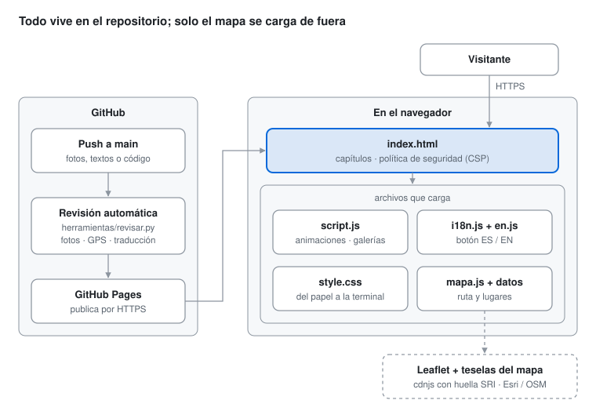

#  Mi bitácora

**De la veterinaria a la inteligencia artificial: el camino, entrada por entrada.**

🔗 **Ver la página:** [krma12.github.io/mi-bitacora](https://krma12.github.io/mi-bitacora)

Bitácora digital de mi vida de 2018 a hoy: la veterinaria, la pandemia, el Caribe, Nueva York, un restaurante, la ingeniería en IA y todo lo que sigue. La hice a mano con HTML, CSS y JavaScript como proyecto de la materia **Fundamentos de Desarrollo Web** en Hybridge Education.

> *A digital logbook of my journey from veterinary school to AI engineering. It's handmade with HTML, CSS and JavaScript, and its design turns from a paper diary into a terminal.*

---

##  La idea

La página empieza como un **diario de papel**, con hojas de cuaderno, polaroids y notas escritas a mano. Conforme avanza la historia hacia la tecnología, el diseño **se transforma en una terminal**. El cambio visual cuenta la misma transición que el texto.

Al final la historia vuelve al papel, con una carta a mi yo de 2018.

##  Capítulos

| # | Capítulo | Años | Estilo |
|---|---|---|---|
| 00 | El mapa | 2018 — hoy | papel |
| 01 | La bata blanca | 2018 — 2020 | papel |
| 02 | Rumbo al Caribe | 2020 — 2021 | papel |
| 03 | Nueva York | 2021 — 2024 | papel |
| 04 | Emprender | 2024 — 2025 | papel |
| 05 | Las palabras | 2025 — hoy | papel |
| 06 | Volver a estudiar | 2025 — hoy | **transición** |
| 07 | Hacer con las manos | 2026 — hoy | terminal |
| 08 | Disciplina | 2024 — hoy | terminal |
| 09 | Construir | hoy | terminal |
| 10 | Lo que viene | mañana | terminal |
| ✉ | Carta a mi yo de 2018 | — | papel |

Antes de la carta está **Memorias**: los 3 álbumes más recientes y un botón a [`memorias.html`](https://krma12.github.io/mi-bitacora/memorias.html), la página con todos los álbumes, un filtro por año y la historia de cada uno.

##  Qué tiene

- **Mapa interactivo** ([Leaflet](https://leafletjs.com/)): la ruta CDMX → Caribe → Nueva York → CDMX se dibuja sola, con botones para hacer zoom a cada etapa. Al hacer clic en un lugar, su nota dice si ahí viví, si lo visité o si ahí tengo amigos.
- **Galerías automáticas**: cada sección lee sus fotos de una carpeta, con un visor para verlas en grande.
- **Proyectos en vivo**: el capítulo 09 lee la lista de proyectos de la API de mi [portfolio](https://hugoportfolio.pythonanywhere.com); si no responde, muestra la lista guardada.
- **Versión en inglés**: un botón ES / EN traduce toda la página, sin depender del traductor del navegador.
- **Contadores animados**: algunos números se calculan solos, como los años, los lugares del mapa y los capítulos.
- **Menú que sigue tu lectura**: marca el capítulo actual y se oscurece al llegar a la parte de terminal.
- **Animaciones al hacer scroll**, barra de progreso, efecto *glitch* y máquina de escribir.
- **Diseño responsive**, pensado primero para celular.
- **Vista previa al compartir**: etiquetas Open Graph con imagen, título y descripción para que el link se vea bien en WhatsApp, LinkedIn, Facebook y X.
- **Ícono propio** en la pestaña del navegador (`favicon.svg`).
- **Accesibilidad básica**: se respeta `prefers-reduced-motion`, los botones tienen foco visible y las fotos llevan texto alternativo.

**Tecnologías:** HTML5 · CSS3 (variables, grid, flexbox, animaciones) · JavaScript (IntersectionObserver, promesas) · Leaflet · Python (revisión automática) · GitHub Actions

##  Cómo funciona



Es un sitio **estático**: no tiene servidor ni base de datos. GitHub Pages publica los archivos tal cual. Lo único que llega de fuera es el mapa (Leaflet y sus teselas), las tipografías y la lista de proyectos, que se lee de la API del portfolio.

##  Seguridad y privacidad

Es una página muy personal, así que cuida lo que publica:

| Qué | Cómo |
|---|---|
| **Sin ubicación en las fotos** | Las fotos del celular guardan dónde se tomaron (GPS). Todas se suben sin metadatos, y la revisión automática rechaza cualquiera que los traiga. |
| **Caras de terceros** | En fotos de pacientes o de personas que no dieron permiso, las caras van difuminadas. |
| **Sin correo publicado** | El contacto es por LinkedIn o el portfolio; un correo en la página termina en listas de spam. |
| **Política de seguridad (CSP)** | GitHub Pages no permite configurar encabezados del servidor, así que la CSP va en una etiqueta `<meta>`: solo se ejecutan scripts de este sitio y de cdnjs. |
| **Huella de los archivos externos (SRI)** | Leaflet lleva `integrity`: si alguien alterara el archivo en el CDN, el navegador no lo carga. |
| **API del portfolio** | La página solo puede *leer* la lista de proyectos (`connect-src` en la CSP y CORS del lado del portfolio), y la arma con `textContent`: el texto que llega nunca se ejecuta como HTML. |
| **HTTPS** | GitHub Pages sirve todo por HTTPS. |

##  Revisión automática

En cada push, GitHub Actions corre `herramientas/revisar.py`. Revisa que:

1. existan todos los archivos y fotos que usa la página;
2. cada galería tenga un pie por foto, en español y en inglés;
3. cada texto con `data-i18n` tenga su traducción en `en.js`;
4. las fotos pesen hasta 700 KB y los videos hasta 6 MB;
5. ninguna foto traiga GPS o metadatos y ningún archivo publique un correo;
6. los archivos externos lleven SRI y cada página tenga CSP;
7. cada álbum de `memorias-datos.js` tenga sus datos, fotos y pies en español e inglés.

Si algo falla, el check sale en rojo con la lista de problemas. Para correrla en tu computadora: `pip install pillow` y luego `python herramientas/revisar.py`.

##  Estructura

```
mi-bitacora/
├── index.html        → todo el contenido de la bitácora
├── style.css         → estilos (papel, transición, terminal)
├── script.js         → animaciones, menú y galerías automáticas
├── mapa.js           → lógica del mapa y de los contadores
├── mapa-datos.js     → lugares del mapa (aquí se agregan nuevos)
├── i18n.js           → botón ES / EN
├── en.js             → textos en inglés (una clave por cada data-i18n)
├── proyectos-vivo.js → lista de proyectos en vivo desde la API del portfolio
├── memorias.html     → página de Memorias (cuadrícula, filtro por año y vista de cada álbum)
├── memorias-datos.js → los álbumes: fecha, título, historia, cita y pies de foto (ES/EN)
├── memorias.js       → arma los álbumes en memorias.html y el adelanto en index.html
├── favicon.svg       → ícono de la pestaña
├── vista-previa.jpg  → imagen que aparece al compartir el link (1200 × 630)
└── img/              → una carpeta de fotos por sección
    ├── veterinaria/
    ├── playa_del_carmen/
    ├── tulum/
    ├── new_york/
    ├── restaurante/
    ├── cdmx_carrera/
    ├── impresion_3d/
    ├── gimnasio/
    ├── arqueria/
    └── memorias/
├── herramientas/
│   └── revisar.py    → revisión automática
├── docs/
│   └── arquitectura.svg
└── .github/          → workflow de la revisión + Dependabot
```

##  Cómo actualizarla

**Agregar fotos:** ponlas en la carpeta de su sección como `1.jpg`, `2.jpg`, `3.jpg`… y actualiza en `index.html` el número de fotos (`data-fotos="N"`) y los pies de foto en español (`data-pies="Primero|Segundo|…"`) e inglés (`data-pies-en`). Antes de subirlas, quítales los metadatos; si se te olvida, la revisión automática te avisa.

**Agregar un álbum a Memorias:** crea `img/memorias/<nombre>/` con `1.jpg`, `2.jpg`… y agrega un bloque en `memorias-datos.js` (las instrucciones están al inicio del archivo). No hay que tocar el HTML. La revisión automática comprueba que el archivo sea JSON válido y que cada álbum tenga sus fotos, textos y pies en los dos idiomas.

**Cambiar un texto:** cambia el español en `index.html` y su versión en inglés en `en.js` (misma clave del `data-i18n`).

**Agregar un lugar al mapa:** en `mapa-datos.js`, copia una línea y cambia el nombre y las coordenadas. El orden de la lista es el orden en que se dibuja la ruta.

```js
{ nombre: "Nuevo lugar", etapa: "nuevayork", lat: 40.75, lng: -73.98, nota: "Lo que pasó aquí", zona: "nyc" },
```

**Marcar una meta cumplida:** en el capítulo 10, cambia `[ ]` por `[✓]`.

**Cambiar la vista previa del link:** reemplaza `vista-previa.jpg` por otra imagen de 1200 × 630 px con el mismo nombre. El título y la descripción están en las etiquetas `og:` del `<head>` de `index.html`. Para comprobar cómo se ve, usa [opengraph.xyz](https://www.opengraph.xyz/) o el [LinkedIn Post Inspector](https://www.linkedin.com/post-inspector/). WhatsApp guarda la vista previa anterior por un tiempo, así que puede tardar en actualizarse.

## 💻 Verla en tu computadora

No necesita instalar nada: abre `index.html` con doble clic. El mapa necesita conexión a internet para cargarse.

##  Créditos

- Mapas: [Leaflet](https://leafletjs.com/) · teselas de [Esri](https://www.esri.com/) y [OpenStreetMap](https://www.openstreetmap.org/copyright)
- Tipografías: [Fraunces](https://fonts.google.com/specimen/Fraunces), [Caveat](https://fonts.google.com/specimen/Caveat) y [JetBrains Mono](https://fonts.google.com/specimen/JetBrains+Mono) (Google Fonts)

---

**Hugo Maldonado** · Estudiante de Ingeniería en Inteligencia Artificial

[Portfolio](https://hugoportfolio.pythonanywhere.com) · [GitHub](https://github.com/krma12) · [LinkedIn](https://www.linkedin.com/in/hugo-maldonado-a20445201/) · [Impresiones 3D @vxlmexico](https://www.instagram.com/vxlmexico/)

*La bitácora sigue abierta.* ▋
